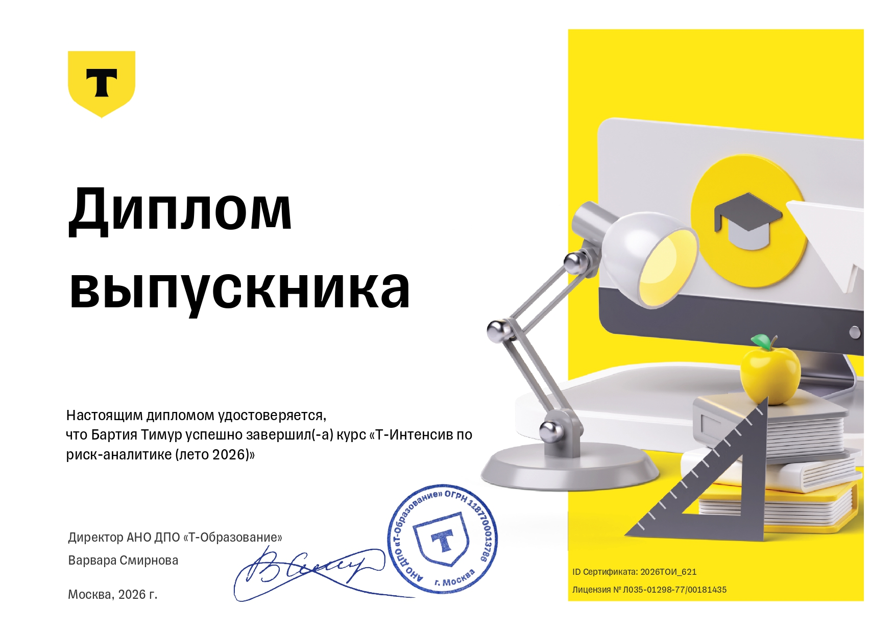

# Интенсив по риск-аналитике. Август 2026.
## Темы:
- Основы A/B тестирования:
    - Статистика
    - Проверка гипотез
- A/B-тесты в рисках
- Causal inference:
    - Корреляция vs Каузация
    - Проверка гипотез, когда A/B-тест не работает
- Логистическая регрессия:
    - Вывод формул
    - WoE
- Деревянные модели:
    - Бустинг
    - feature importance
- Отбор переменных:
    - Фильтрующие методы (корреляция, WoE, Information Value)
    - Обёрточные методы (forward/bacward selection, Stepwise selection)
    - Embedded (featrue importance, sharp values, permutation importance)
- ML system design:
    - Цикл построение модели
    - Data drift
- DL в рисках:
    - CNN, RNN и другая классика
    - Transformers
- NPV-модель:
    - Построение модели
    - Построение кривых распределений
- LTV-модель
- Прочее:
    - SME risks
    - ALM и финансовые риски
    - Антифрод и страхование

